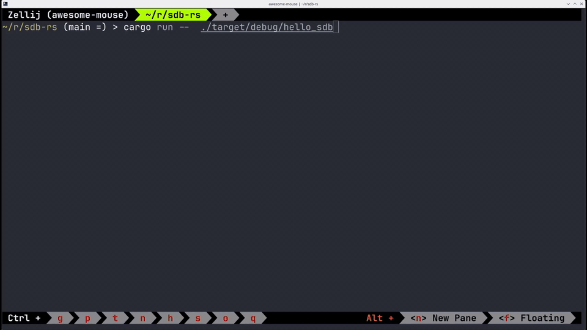

# sdb-rs

[](https://github.com/kevinjoseph1995/sdb-rs/actions/workflows/rust.yml)

**sdb-rs** is a learning-oriented re-implementation of the **sdb** debugger described in Sy Brand’s wonderful book [*Building a Debugger*](https://nostarch.com/building-a-debugger).



## Fuzzing

The `fuzz/` crate holds cargo-fuzz targets for the byte and text parsers. It needs a nightly toolchain, so use the dedicated shell:

```
nix develop .#fuzz
cargo fuzz run <target> -- -max_total_time=60
```

Targets: `cursor_ops`, `dwarf_abbrev`, `dwarf_compile_units`, `elf_parse`, `register_value_parse`.
Crashing inputs land in `fuzz/artifacts/<target>/`. Replay one with `cargo fuzz run <target> <file>`.
